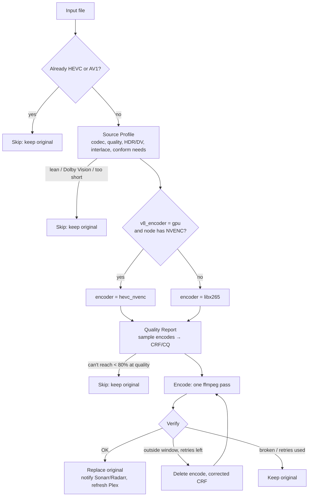

# Adaptive HEVC for Tdarr

A set of four [Tdarr](https://home.tdarr.io/) flows that convert a media library to HEVC (H.265) with **one encode per
file**, choosing the quality setting for each file by **test-encoding samples** instead of guessing.

> **Status:** in daily use on a ~33k-file library (Tdarr 3.01). Treat it as beta on your own library: start with one
> library or a test folder and read the first few job logs.

---

## About

Most HEVC flows pick a fixed CRF, or a CRF from a bitrate table, and then either accept whatever size comes out or loop
re-encoding until the size lands in a window. Both waste time or quality: a CRF that halves a grainy Blu-ray encode can
inflate a lean WEB-DL to twice its size, and every retry is another full CPU encode.

This flow measures instead. Before encoding, it cuts three short samples from the file, encodes them with the exact
settings the real encode will use, and measures the **size** and **SSIM quality** of the result. It searches for the
CRF that lands the whole file near **50% of its original size**, never below **40%**, and never below the quality floor.
Then it encodes once. A verify step checks the real result and allows a single corrected retry if the estimate missed.

## Features

- **Per-file CRF from a quality report.** Three samples spread through the file, encoded with the real settings; the
  search brackets the target size and interpolates on the measured size curve (up to 5 rounds).
- **Size rules for the whole file, for every source type.** Target 50% of the original, never below 40%, skip if it
  can't get under 80%. Audio and subtitles are copied, so the rule is converted to a video target per file.
- **Quality floor.** Every candidate CRF must keep SSIM ≥ 0.975 against the source samples. Quality wins over size.
- **Source assessment before anything is encoded.** Codec, resolution, frame rate, bits-per-pixel quality (adjusted for
  codec efficiency: MPEG-2, XviD, VC-1, H.264…), HDR10/HLG and Dolby Vision. Already-lean sources are skipped with the
  reason logged. Stale MKV bitrate tags are cross-checked against the real file size.
- **One encode pass with all conforming built in.** No separate remux pass, and the original is replaced only once, at
  the end:
  - deinterlace (bwdif) when the stream is interlaced: from the field order, else detected with `idet` for SD and legacy codecs
  - regenerate timestamps for AVI / MPEG-PS / TS sources
  - crop odd dimensions to even
  - MP4/WebVTT text subtitles → SRT; SRT/ASS and image subtitles (PGS, VobSub, DVB) copied; unsupported ones dropped
  - PCM variants MKV can't hold → FLAC; all other audio copied untouched
  - data streams and cover art dropped; font attachments kept; streams ordered video, audio, subtitles, attachments; MKV
- **HDR10 / HLG preserved.** Colour primaries, transfer, matrix, mastering display and content light level are carried
  into x265 (`hdr10`, `master-display`, `max-cll`).
- **Never larger than the source.** x265 VBV caps the encode at the source video bitrate.
- **Verify with a bounded retry loop.** Checks HEVC output, duration and audio track count, and the size window.
  Outside the window it re-encodes with a CRF corrected from the *real* full-file result, up to `v8_max_retries`
  (default 1).
- **CPU or GPU path.** CPU libx265 (`slow`) by default for the best compression; NVENC (`hevc_nvenc`, CQ) when you ask
  for it and the node has it. HDR always takes the CPU path so its metadata survives.
- **Notifies your stack.** Replaces the original, then notifies Sonarr or Radarr and refreshes the Plex library.
- **Readable logs.** Every decision is logged with a `[source profile]`, `[quality report]`, `[build encode]` or
  `[verify]` prefix. See [docs/job-log.md](docs/job-log.md).

## How it works



| Flow | File | What it does |
|---|---|---|
| 1 Report | `flows/1 - Report.yml` | HEVC/AV1 skip → Source Profile → CPU/GPU choice → Quality Report |
| 2 Encode | `flows/2 - Encode.yml` | Builds and runs the single encode command |
| 3 Verify | `flows/3 - Verify.yml` | OK → flow 4 · keep original · retry → flow 2 |
| 4 Notify | `flows/4 - Notify.yml` | Replace original, notify Sonarr/Radarr, refresh Plex |

Only flow 1 is assigned to a library; the others are reached with *Go To Flow*.

## Requirements

- **Tdarr 3.x** (built and tested on 3.01.00) with an internal or external node.
- The node's ffmpeg must include **libx265** (Tdarr's bundled `tdarr-ffmpeg` does). VMAF is not required; the flow uses
  ffmpeg's SSIM filter.
- **CPU**: x265 `slow` is CPU-heavy. A modern 8+ core CPU is recommended.
- **Optional:** an NVIDIA GPU visible to the node for the NVENC path; Sonarr, Radarr and Plex for flow 4.
- To use the build/deploy tools: Python 3.8+ (PyYAML for the `.yml` exports), `bash`, `curl` and `jq`.

## Installation

### Option A: import in the Tdarr UI

1. In Tdarr, open **Flows** and import each file in `flows/` in order: `1 - Report`, `2 - Encode`, `3 - Verify`,
   `4 - Notify`. YAML and JSON contain the same flow; use whichever your Tdarr version accepts.
2. Open **flow 1** and check that the *Go To Flow* steps point at the right flows. The flows reference each other by
   ID (`adaptive_hevc_1_report` … `adaptive_hevc_4_notify`). If an import assigned new IDs, re-select the target flow in each
   *Go To Flow* step (flows 1, 2 and 3), or use Option B, which keeps the IDs.
3. Add the library variables below to the library.
4. In the library's **Transcode Options**, set the flow to **Adaptive HEVC - 1 Report**.
5. Watch the first jobs' logs before letting it loose on everything.

### Option B: upload with the API (keeps the flow IDs)

```bash
git clone <this repo> && cd tdarr-flow
python3 tools/build_flows.py                        # regenerates flows/ from src/ (optional if unchanged)
TDARR_URL=http://<tdarr-host>:8265 tools/deploy.sh  # add TDARR_API_KEY=... if API auth is on
```

Then do steps 3–5 above. `deploy.sh` creates the flows, or updates them in place if they already exist.

## Library variables

### Required (flow 4: notify)

```text
library_name     TV Shows                 # "TV Shows" -> Sonarr + Plex TV refresh; anything else -> Radarr + Plex movie refresh
sonarr_url       http://sonarr:8989       # used when library_name is "TV Shows"
sonarr_api_key   <key>
radarr_url       http://radarr:7878       # used for every other library
radarr_api_key   <key>
plex_url         http://plex:32400
plex_token       <token>
plex_library     <section id>             # Plex library section to refresh (movie libraries)
```

Flow 4 runs the notifications with "continue on failure", so a missing Sonarr/Radarr/Plex doesn't fail the job.

### Optional (tuning; library or global variables)

```text
v8_encoder       cpu      # cpu (default, best compression) | gpu (NVENC when the node has it; HDR still uses CPU)
v8_target_ratio  0.50     # aim for this fraction of the original file size
v8_min_ratio     0.40     # never shrink the file below this fraction
v8_max_ratio     0.80     # skip files that can't get under this fraction at acceptable quality
v8_ssim_floor    0.975    # minimum SSIM of the test encodes vs the source (higher = stricter quality)
v8_max_retries   1        # extra full encodes Verify may run with a corrected CRF
```

## Results

Measured with the Quality Report (x265 `slow`, SSIM floor 0.975, target 50% / minimum 40%):

| Source | CRF chosen | Whole file | SSIM | Notes |
|---|---|---|---|---|
| 480p WEB-DL H.264, 1.3 Mbps | 20 | **45.2% (real job)** | 0.988 | Report predicted 47% |
| 1080p Blu-ray x264, grainy, 5.8 Mbps | 21 | ~49% | 0.983 | Very steep curve: CRF 27 → 14%, CRF 17 → 107% |
| 2160p WEBRip x264, 27 Mbps | 16 | ~52% | 0.994 | |
| 1080p WEB-DL H.264, lean, 4.5 Mbps | 26 | ~64% | 0.975 | Held at 64% by the quality floor (CRF 28 = 51% but SSIM 0.972) |
| 480i MPEG-2 (interlaced) | 17 | ~48% | 0.982 | Deinterlaced, timestamps regenerated |
| 384p XviD AVI | 25 | ~49% | 0.984 | Timestamps regenerated |

A fixed CRF can't serve all of these: CRF 26 is right for the lean WEB-DL and would take the grainy Blu-ray to ~7%.

## Known limitations

- **No VMAF.** Tdarr's bundled ffmpeg has no libvmaf, so quality is judged with SSIM. SSIM barely penalises lost film
  grain; the 40% minimum is what stops grainy sources from being over-compressed.
- **The report costs time.** Measured on a 16-core Ryzen while other Tdarr jobs were running: 2–5 minutes for SD,
  7–16 minutes for 1080p, ~20 minutes for 4K. Expect less on an idle CPU. This is small next to a full x265 `slow`
  encode, but it isn't free.
- **Estimates can miss.** Three samples stand in for the whole file. Verify catches misses and retries once by default;
  after that, a 70–85% result is accepted and anything else keeps the original.
- **HEVC and AV1 sources are never re-encoded**, even if they are large.
- **Dolby Vision is skipped** (x265 would drop the DV layer). **HDR10+** dynamic metadata isn't carried over (static
  HDR10 metadata is).
- **Only the first video stream is encoded**; extra video streams are copied. **Audio is not transcoded** (copied as is,
  except PCM that MKV can't hold).
- **Output is always MKV.**
- **The GPU (NVENC) path is less tested** than the CPU path, and its CQ range is only a starting estimate.
- CRF is searched within 16–34 (x265) / 18–38 (NVENC CQ). A source needing CRF < 16 to stay above 40% is clamped at 16.
- Flow 4 decides TV vs movie purely by `library_name == "TV Shows"`.

## Testing

`test/` runs the flow steps outside Tdarr, inside the Tdarr node container (so the same `tdarr-ffmpeg` is used). Put
the project somewhere the container can see, e.g. a mounted config folder, then:

```bash
# flow 1 on a real file: Source Profile + Quality Report (no output written)
docker exec tdarr node /path/in/container/tdarr-flow/test/harness.js "/media/Show/S01E01.mkv" \
  /path/in/container/tdarr-flow/src/source_profile.js /path/in/container/tdarr-flow/src/quality_report.js

# flows 2+3 on a short clip at a given CRF: builds the exact ffmpeg command, encodes, runs Verify
docker exec tdarr node /path/in/container/tdarr-flow/test/harness_encode.js /tmp/clip.mkv 22
```

`V8_VARS='{"v8_ssim_floor":"0.97"}'` (passed with `docker exec -e`) sets library variables for `harness.js`.

## Project structure

```text
flows/              importable flows, generated (one .yml + .json per flow, all-flows.json for deploy.sh)
src/                the JavaScript that runs inside the flows' Custom Function steps
  source_profile.js   flow 1: assess the original, decide skip, record conform needs
  quality_report.js   flow 1: sample encodes -> CRF/CQ
  build_encode.js     flow 2: the single ffmpeg command
  verify.js           flow 3: integrity, size window, retry decision
  templates/notify_flow.json   flow 4 (replace + Sonarr/Radarr + Plex)
tools/build_flows.py  generates flows/ from src/ (the code is embedded in the flows)
tools/deploy.sh       uploads flows/ to a Tdarr server through its API
test/               harnesses to run the steps outside Tdarr
docs/job-log.md     what each log line and skip/retry reason means
```

Edit the `.js` files, run `python3 tools/build_flows.py`, then re-import or run `tools/deploy.sh`. Don't edit the
code inside `flows/` by hand; it's overwritten on the next build.

## FAQ

**A file was skipped. Why?** The job log says exactly why: search for `SKIP` or `KEEP ORIGINAL`. Common reasons are
*already hevc*, *already lean*, *Dolby Vision*, or *only gets the file to ~85% (skip above 80%)*.

**Why is my file 60–65%, not 50%?** The quality floor stopped the search. Lean WEB-DL sources often can't reach 50%
without dropping below SSIM 0.975. Lower `v8_ssim_floor` (e.g. 0.97) if you prefer size over quality.

**Can I use the GPU?** Set `v8_encoder` to `gpu`. The flow checks the node really has NVENC and falls back to CPU if not.
CPU x265 gives noticeably better compression at the same quality, which is why it's the default.

**Why did a job encode twice?** Verify measured the real file outside the 37–70% window and retried once with a
corrected CRF. The log shows `RETRY 1/1` with the old and new values.

**Does it touch my originals before it's sure?** No. The original is only replaced in flow 4, after Verify has passed.

## Release notes

See [CHANGELOG.md](CHANGELOG.md).

## Credits

Inspired by the structure of [Tdarr-One-Flow](https://github.com/imthekaiser/Tdarr-One-Flow). Built on Tdarr's
community flow plugins and FFmpeg / x265.

## License

No license has been chosen yet. Add a `LICENSE` file before publishing.
